<p align="center">
  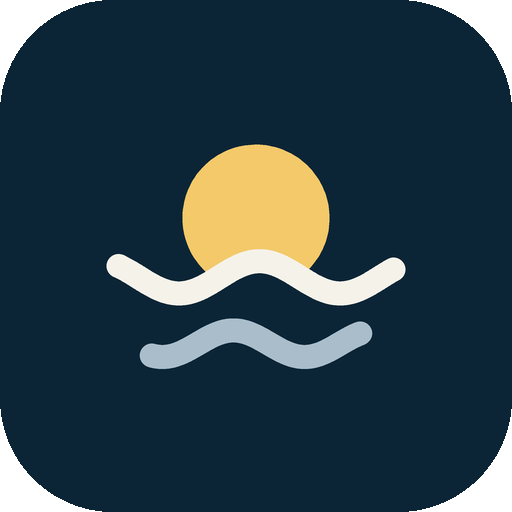
</p>

<h1 align="center">🌊 Language Coast</h1>

<p align="center">
  An AI-powered flashcard app for Android, with an iOS version on the way. Built with Kotlin Multiplatform and Compose Multiplatform, with translation on your phone or by the cloud AI of your choice.
</p>

<p align="center">
  <a href="https://github.com/Andreas-Erick/LanguageCoast/actions/workflows/ci.yml"></a>
  <a href="https://github.com/Andreas-Erick/LanguageCoast/actions/workflows/ios.yml"></a>
  
  
  
  
</p>

---

Language Coast is a flashcard app that changes how you build vocabulary. It combines AI translation with a coastal-themed UI. Each language you learn gets its own **Coast** (e.g. a *German Coast* and an *Icelandic Coast*), and each coast has a reason: a trip, a person, a job. Every day, Today offers one short session: a few due cards, then a few new sentences picked for that reason, to keep or skip. Type your own sentence whenever you like, and the AI translates it and files it into one of that coast's "Language Islands", ready to study.

## 📱 Screenshots

<p align="center">
  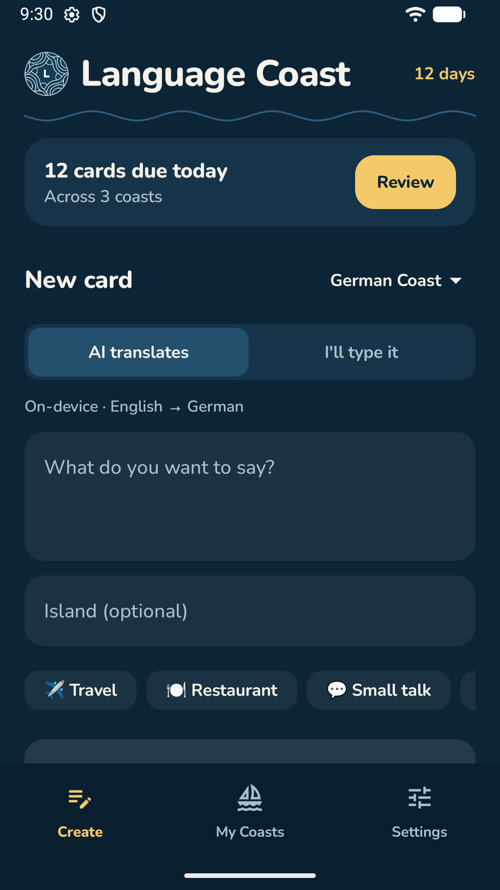
  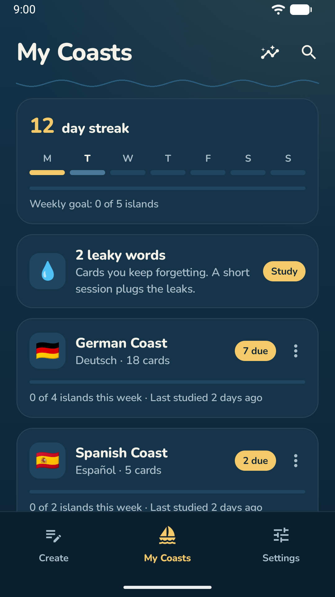
  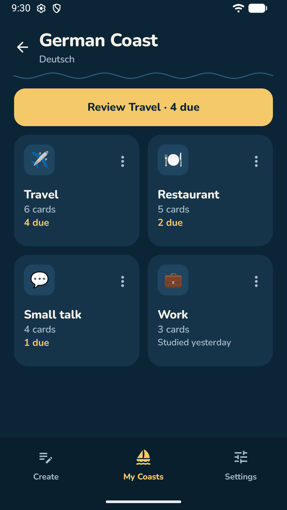
  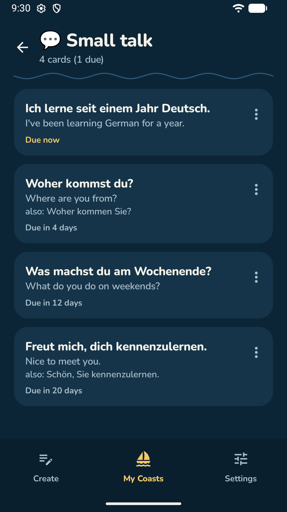
  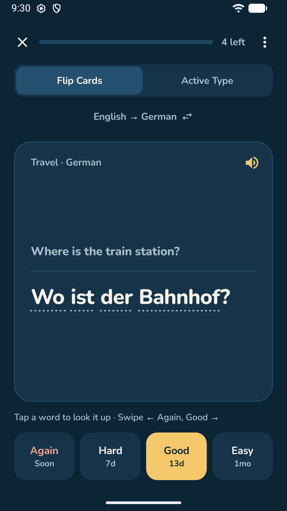
  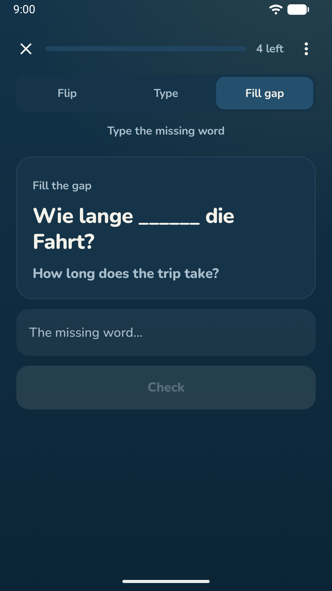
  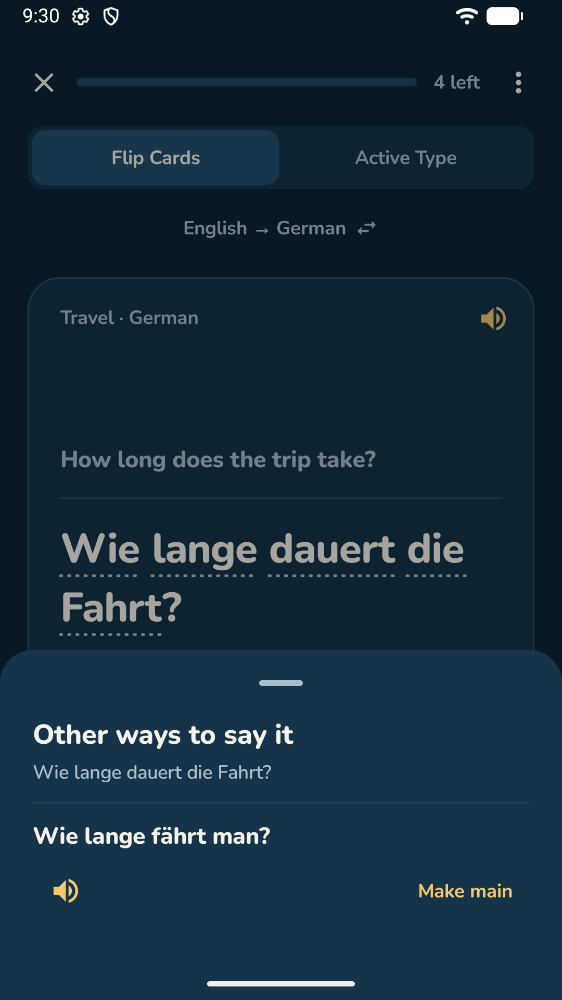
  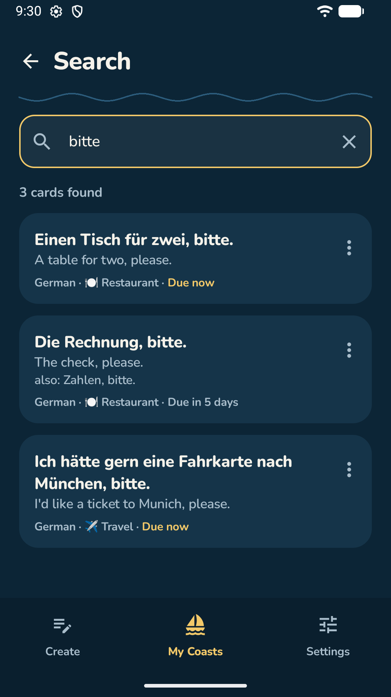
  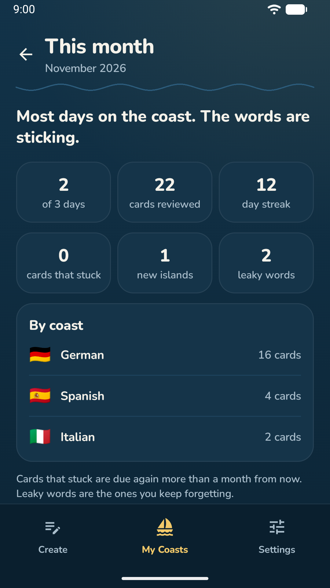
  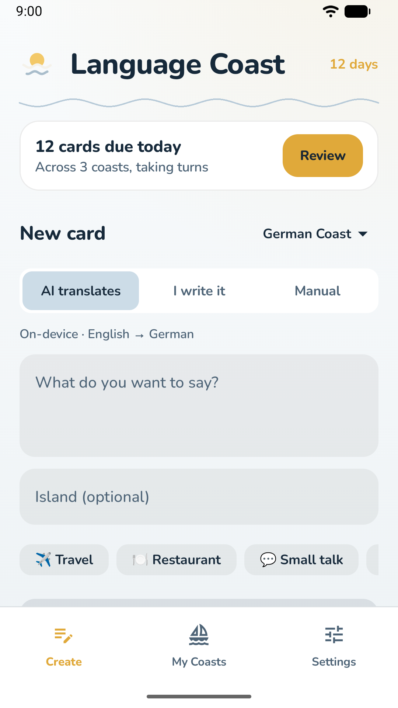
  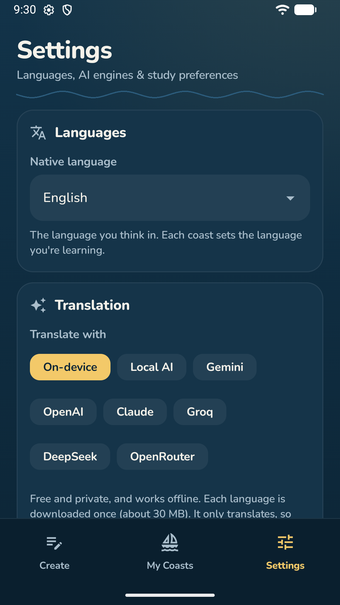
  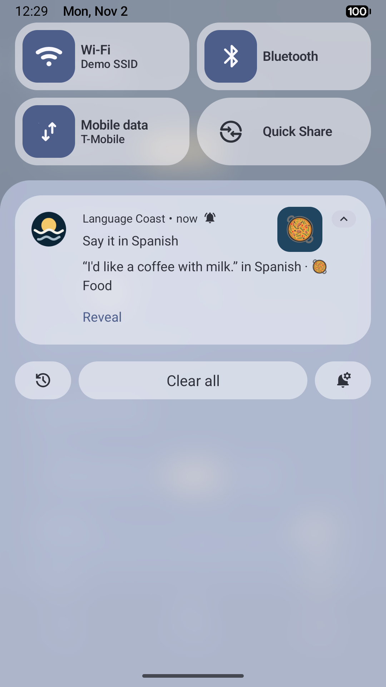
  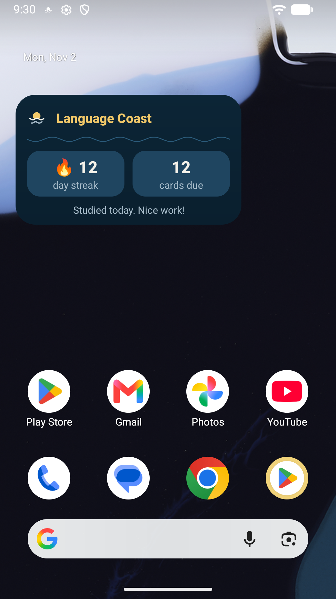
</p>

## ✨ Features

### ☀️ Today
- **One session a day, always finishable**: Today shows the coast you focus on and one button. The session reviews at most 12 due cards (the rest wait for another day, with *Review all* if you insist), then offers up to 3 new sentences.
- **A goal per coast**: say why you learn the language (*A trip to Lisbon in March*, *Talking with Anna's parents*). It is shown on Today, and the new sentences are picked for it.
- **Sentences come to you**: a pool of sentences is prepared in the background by your AI provider (local or cloud), fitted to the goal, your level and the islands you have, avoiding what you already know. Without an AI model, the starter sentences are translated on the device instead. Each new sentence is shown with both sides; *Keep it* makes it a card that you practice at the end of the session, *Skip* means it isn't offered again.
- **Starter sentences**: about 650 sentences and words everyone needs, in 27 topics. Situations: greetings and politeness, getting by in the language, small talk and weather, about me (including your age), restaurant, directions, airport, getting around, hotel, shopping, help and health, making plans, phone and internet, money and bank, home and renting, paperwork, wishes and toasts, telling the time. Building blocks: days, months and seasons, numbers (0 to 30 in full, the tens, hundreds, thousands up to a billion, ordinals, halves, percent, years: everything any number is built from), everyday words, question words, family and people, colours, food and drink, signs you read on the street, and the words your phone's Settings app uses once you switch it to the language (Wi-Fi, notifications, permissions, Save, Allow, Turn off...). Tick the ones you'd say, fill in blanks like *[city]* or *[name]* (*[language]* fills itself), and they are translated and filed on islands. Sentences your coast already has are marked.
- **The basics first**: for about the first six weeks (120 sentences) the new sentences come from the starter bank, in a sensible order (greetings, getting by, small talk, about you, then the situations your goal points to), translated by your provider. After that the AI suggests sentences for your goal, and the bank stays the fallback.
- **Welcome back, not a backlog**: after three or more days away, the session shrinks to 5 cards and 2 new sentences.
- **Your streak** in the header, the **new card form** folded away under *Add your own*, and the **cards you added most recently** to that coast.
- **Three-step onboarding**: the language you speak, your first coast, then why you learn it.

### 🤖 AI-powered card creation
- **Translate however you like**, picked in Settings:
  - **On-device** (Google ML Kit): free, private and offline once a language is downloaded (about 30 MB). It only translates, so cards go into the island you type. Covers every app language except Bosnian, Latin and Serbian.
  - **Local AI** (Android): a language model that runs on your phone with Google LiteRT-LM. The app scans your phone's RAM, storage and processor, recommends models that fit (Qwen 3, LFM2.5 and Gemma 4 download straight away; Gemma 3 is gated on Hugging Face and needs a token from there), and downloads the one you pick in the background. Free, private and offline, and unlike the on-device translator it also sorts cards into islands and suggests alternatives.
  - **Cloud AI** with your own API key: **Google Gemini**, **OpenAI**, **Anthropic Claude**, **Groq**, **DeepSeek** or **OpenRouter** (one key for many models; `openrouter/auto` picks one for you, or enter any model ID).
- **Auto-categorization**: the AI models sort each new card into an island such as *Travel*, *Restaurant* or *Greetings*, reusing your existing islands whenever one fits.
- **Icelandic noun rule**: single Icelandic nouns are returned with their definite and plural forms (e.g. *hestur, hesturinn, hestar*).
- **Island emojis**: the AI models also pick an emoji for each new island (🍽️ *Restaurant*, ✈️ *Travel*).
- **Write it yourself**: switch to *I write it* and write the sentence in the coast's language. The AI fills in your language, corrects spelling and grammar slips, and the saved card shows what it changed.
- **Manual mode**: you can skip the AI and enter your own translation and island.
- **Add many at once**: paste a paragraph, or read the text off a photo of a page or a sign (Android, on the phone), tick the sentences you want and they become cards one after the other.
- **Island suggestion**: while you type, the island whose cards share the most words with your sentence is suggested before the AI sees it.
- **Instant preview with undo and edit**: after saving you see the card that was created, can undo it right away, or fix the translation in place with the pencil.
- **Patient with local models**: the model is loaded as soon as Today opens, the button shows how long it has been thinking, and after two unreadable answers a cloud provider you have a key for is offered instead.
- **Alternatives for longer sentences**: for sentences of 6 words or more, the AI models also suggest up to two other translations with a note on how they differ (e.g. formal vs. informal). They are saved with the card: after flipping it, *2 alternatives* opens a sheet with the note, a read-aloud button for each and *Make main* to swap one with the card's translation. Alternatives also count as correct in Active Type and are included in exports.

### 🏝️ My Coasts
- **One coast per language**: study several languages side by side, each with its flag and its own islands. The focus coast, which Today's session and new cards are on, is switched right on Today.
- **Starter topics as islands**: a coast lists the starter topics it doesn't have yet (*+ 🔢 Numbers · 88*). One tap adds the whole topic as an island, translated in the background with a progress bar you can walk away from. Topics that use your name, city, country or job ask for them once; sentences with a blank per sentence (*[number]*, *[time]*) stay in the starter list on Today. A language model translates a topic 15 sentences at a time with one prompt that carries the topic's rules (natural wording, the polite form of address with strangers, dictionary forms with articles for single words, numbers as words, the phone's own wording for its settings), so the entries are consistent with each other; the on-device translator goes sentence by sentence. *Add all* adds every remaining topic at once, with a count and a time estimate, if you really want it.
- **Language Islands**: on each coast, your vocabulary is grouped into islands by category, each with its emoji, card count and how many cards are due. A coast with cards due offers one session over all of its islands.
- **Progress at a glance**: coasts show how many islands you explored this week, and the streak card tracks your **weekly island goal** (3, 5, 7 or 10, picked in Settings).
- **Leaky words**: cards you have forgotten twice, or that the scheduler rates hard, are gathered into a short booster session of their own.
- **Monthly recap**: days studied, cards reviewed, cards that stuck, new islands and each coast's share, as a page and as a picture to share (Android).
- **Island card list**: *See cards* in an island's ⋮ menu (or *All cards* in the ⋮ menu while studying) shows every card with its translation, alternatives and when it is due next.
- **Search**: the search icon on My Coasts finds cards on every coast by their native text, translation or alternatives, and shows which coast and island each is on.
- **Duplicate hint**: while you type a new card, Today tells you if the coast already has that sentence and on which island.
- **Edit cards**: fix a card's native text, translation or alternatives, or move it to another island, without losing its review progress.
- **Daily streaks with a freeze**: a streak counter and a bar for each day of the week track your study days. One missed day a week is covered automatically by a streak freeze, shown on the bar.
- **Undo instead of "Are you sure?"**: deleted coasts, islands and cards can be restored from the snackbar.
- **Offline-first storage**: cards are stored locally with **Room**, and preferences with **Jetpack DataStore**.

### 🧠 Study modes
- **Spaced repetition**: cards are scheduled with [FSRS](https://github.com/open-spaced-repetition/awesome-fsrs/wiki/The-Algorithm), the algorithm Anki uses, so each island only asks for the cards that are due. Islands and coasts show how many cards are due, and the daily reminder says how many are waiting. When nothing is due you can still practice all cards.
- **Focus mode**: a study session takes the whole screen, with just a progress bar, the card and the grade buttons. Previous card, Skip card and the island's card list are in the ⋮ menu.
- **Flip Cards**: classic flashcards with an animated flip. Grade each card *Again*, *Hard*, *Good* or *Easy* (each button shows when the card comes back), or swipe left for *Again* and right for *Good*. *Again* shows *Soon*: it moves the card to the end of the session, so you see it again before you finish.
- **Type**: test your recall by typing the translation. Capitalization, punctuation and extra spaces don't count against you, accents do. A correct answer is graded like a flipped card; a slip of a letter is *Almost!* and counts as *Hard*; a wrong one counts as *Again* and the card comes back later in the session.
- **Fill gap**: the translation with its key word blanked out and the sentence in your language as the hint. Type the missing word.
- **Read aloud**: a speaker button reads the translation in the coast's language, using the voices installed on your phone (free and offline). It only appears when the phone has a voice for that language.
- **Study the other way round**: swap the direction under the mode switch to see the translation first and answer in your native language, training recognition instead of recall. Works with Flip Cards and Active Type, and is remembered for later sessions.
- **Session summary**: finishing an island shows a short celebration with your stats and streak.
- **Explain this word**: tap any word on the back of a card and your AI provider explains it as used in that sentence (meaning, form, one more example), with a **dict.cc** link alongside. dict.cc uses your language pair when it has it (it pairs every language with English or German) and falls back to the English dictionary otherwise.
- **Feedback you can switch off**: a short buzz and a soft tone for flips and grades, each with its own switch in Settings.

### 🔔 Study reminders
- A daily reminder, scheduled with **WorkManager**: at a surprise time between 9:00 and 21:00, or at a fixed time you pick in Settings. It can also be turned off. On iPhone the reminders are queued with the system's notifications instead, so they don't say how many cards are due.
- **A different reminder every day**: how many cards are due, a due card quoted as a quick self-test (*"Where is the train station?" in German*), a streak that ends tonight, a milestone within reach (day 7, 30, 100, ...), or *All caught up*. Each has its own picture and wording, rotated so two days in a row never look the same.
- **Answer from the notification** (Android): the quoted card has a *Reveal* button, and the revealed card *Got it* / *Forgot*, which grade it without opening the app.
- **Home-screen widget** (Android): the cards due today and your streak, a gentler nudge than a notification. It refreshes every hour and whenever you leave the app, and tapping it opens the app.

### 📤 Export, import & backup
- **Export to Anki**: save one coast or all of them as a text file that Anki imports with *File › Import*. Each island becomes a subdeck (e.g. *German Coast::Greetings*), and alternatives and notes go on the back of the card. Review progress isn't exported, so cards start fresh in Anki.
- **Export to Markdown**: one table per island, to read, print or keep in your notes app.
- **Import from CSV or tab-separated files**, e.g. a spreadsheet or an Anki notes export. A third column (or Anki's deck column) picks the island, a header row is detected, and cards the coast already has are skipped. Imports can be undone.
- **Full backup and restore**: one JSON file with every coast, island and card including review progress, plus the streak, study days and settings, for moving to a new phone. API keys are left out. Restoring replaces everything after a confirmation, and can be undone.
- Files are saved and opened with the system file picker, so they can go to Downloads, Google Drive and so on. The app needs no storage permission.

### ❓ Built-in guide
- **How to use**: a button in Settings opens a short guide to coasts and islands, creating cards, translation, studying, streaks, reminders and the widget, and exporting, importing and backing up.

**Supported languages:** all 28 dict.cc languages (Albanian, Bosnian, Bulgarian, Croatian, Czech, Danish, Dutch, English, Esperanto, Finnish, French, German, Greek, Hungarian, Icelandic, Italian, Latin, Norwegian, Polish, Portuguese, Romanian, Russian, Serbian, Slovak, Spanish, Swedish, Turkish, Ukrainian), plus Japanese and Korean without dictionary lookup. The language picker can be searched by English or native name (e.g. *Deutsch*, *Suomi*).

## 🛠️ Tech stack

| Area | Library |
| --- | --- |
| Architecture | MVVM: ViewModels + repositories, unidirectional data flow with `StateFlow` |
| Code sharing | [Kotlin Multiplatform](https://kotlinlang.org/docs/multiplatform.html): UI, ViewModels, data layer and translation in a `shared` module used by the Android and iOS apps |
| Dependency injection | [Koin](https://insert-koin.io/) |
| UI | [Compose Multiplatform](https://www.jetbrains.com/compose-multiplatform/) + Material 3 (Jetpack Compose on Android), 100% Kotlin |
| Translation | [Gemini](https://ai.google.dev/api/generate-content), [OpenAI](https://platform.openai.com/docs/api-reference), [Anthropic](https://docs.anthropic.com/en/api), [Groq](https://console.groq.com/docs), [DeepSeek](https://api-docs.deepseek.com/) and [OpenRouter](https://openrouter.ai/docs) APIs over [Ktor](https://ktor.io/); [LiteRT-LM](https://github.com/google-ai-edge/LiteRT-LM) for local models and [ML Kit Translation](https://developers.google.com/ml-kit/language/translation) on-device (both Android) |
| Database | [Room](https://developer.android.com/kotlin/multiplatform/room) (Kotlin Multiplatform) |
| Preferences | [Jetpack DataStore](https://developer.android.com/kotlin/multiplatform/datastore) (Kotlin Multiplatform) |
| Navigation | [Navigation Compose](https://kotlinlang.org/docs/multiplatform/compose-navigation-routing.html) (multiplatform) with type-safe routes |
| Spaced repetition | [FSRS-5](https://github.com/open-spaced-repetition/awesome-fsrs/wiki/The-Algorithm) with its default parameters (implemented in `shared/.../data/SpacedRepetition.kt`) |
| Text-to-speech | Android [`TextToSpeech`](https://developer.android.com/reference/android/speech/tts/TextToSpeech) / iOS `AVSpeechSynthesizer`, with the voices installed on the phone |
| Reminders | [WorkManager](https://developer.android.com/topic/libraries/architecture/workmanager) on Android, `UNUserNotificationCenter` on iOS |
| Home-screen widget | [`AppWidgetProvider`](https://developer.android.com/develop/ui/views/appwidgets) with `RemoteViews` (no extra library, Android only) |
| Backups | [kotlinx.serialization](https://github.com/Kotlin/kotlinx.serialization) JSON |
| Testing | kotlin.test (shared module), JUnit 4, kotlinx-coroutines-test, hand-written fakes |
| CI/CD | GitHub Actions (tests on every pull request and push to `main`; shared code tested and the iOS app built and launched on a macOS runner; signed APK on every release tag) |

## 🏗️ Architecture

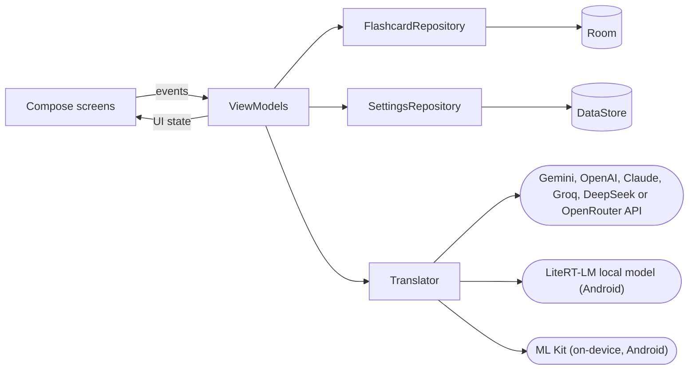

- **Screens** are stateless: they render a UI state and forward user events to their ViewModel.
- **ViewModels** hold the screen logic, e.g. `StudyViewModel` runs the study session (every grade reschedules the card, *Again* re-queues it, completing a session updates the streak).
- **Repositories** are interfaces with one production implementation each, provided by Koin. Tests swap them for in-memory fakes, so all ViewModel logic is tested without a device.

## 📁 Project structure

```
shared/src/                  # Kotlin Multiplatform code for Android and iOS
├── commonMain/
│   ├── kotlin/…/languagecoast/
│   │   ├── App.kt           # Bottom navigation and NavHost
│   │   ├── data/            # Room database, repositories, DataStore settings, translators (cloud providers,
│   │   │                    # local AI models), spaced repetition, search, import/export formats, backups
│   │   ├── di/              # Koin modules
│   │   ├── navigation/      # Type-safe route definitions
│   │   ├── notifications/   # Reminder scheduling interface and timing
│   │   └── ui/              # Each feature's Screen and ViewModel, shared composables and the theme
│   └── composeResources/    # Nunito font and the logo mark
├── androidMain/             # Android implementations: database and settings files, ML Kit, the LiteRT-LM engine,
│                            # text-to-speech, file import/export and backup, date and time formats
├── iosMain/                 # iOS implementations, plus the entry point and notification reminders
└── commonTest/              # Tests that run on every platform

app/src/main/java/com/andreaserick/languagecoast/   # The Android app
├── LanguageCoastApplication.kt  # Starts Koin
├── MainActivity.kt          # Splash screen, notification permission, shows the shared UI
├── di/                      # Koin modules for Android-only parts
├── notifications/           # Daily study reminder (WorkManager + notification)
└── widget/                  # Home-screen widget (streak and cards due)

iosApp/                      # The iOS app: a SwiftUI shell around the shared UI
├── project.yml              # Xcode project description for XcodeGen
└── iosApp/iOSApp.swift
```

## 🚀 Getting started

### Prerequisites
- A recent version of **Android Studio** that supports Android Gradle Plugin 9.2.
- **JDK 21** (Gradle can download it automatically through the toolchain resolver).
- Optionally an API key for a cloud provider: Google Gemini ([Google AI Studio](https://aistudio.google.com/)), OpenAI, Anthropic, Groq, DeepSeek or OpenRouter ([openrouter.ai](https://openrouter.ai/)). On-device and Local AI translation need no key.

### Setup
1. Clone the repository:
   ```bash
   git clone https://github.com/Andreas-Erick/LanguageCoast.git
   ```
2. Open the project in Android Studio and let Gradle sync.
3. Run the app on an emulator or a physical device (Android 8.0 / API 26 or higher).
4. Open **Settings**, choose your native language and how to translate: on-device needs nothing else, Local AI downloads a model, and the cloud providers need their API key.
5. Start a coast for the language you want to learn, then create your first island!

### Running the iOS app
The iOS app needs a Mac with **Xcode** and [XcodeGen](https://github.com/yonaskolb/XcodeGen) (`brew install xcodegen`):
```bash
cd iosApp
xcodegen generate
open iosApp.xcodeproj
```
Then run it on a simulator from Xcode. The first build takes a few minutes, since it compiles the shared Kotlin code. On iPhone, translation uses the cloud providers; on-device translation, Local AI, import/export, backups and the widget are Android-only for now.

> **Your API keys stay on your device.** The app keeps them in local app storage (DataStore). They are never compiled into the app, so you don't need to add them to `local.properties`.

See the [privacy policy](docs/privacy-policy.md) for what the app stores and sends. Store listing texts and form answers are in [docs/store](docs/store/).

### Running tests
```bash
./gradlew testDebugUnitTest :shared:testAndroidHostTest
# On a Mac, the shared tests also run on the iOS simulator:
./gradlew :shared:iosSimulatorArm64Test
```
The unit tests cover the ViewModels, the FSRS scheduler, the streak rules, prompt building and response parsing, editing and searching cards, export, import, backup and restore, answer checking in Active Type (both directions), reminder timing, the date labels and the widget's texts. They run in GitHub Actions on every pull request and every push to `main`; the shared tests also run on the iOS simulator whenever shared or iOS code changes. Database migrations are tested on a device or emulator with `./gradlew connectedDebugAndroidTest`.

## 📦 Releases

Signed APKs are published on the [Releases](https://github.com/Andreas-Erick/LanguageCoast/releases) page. Download the APK on an Android device to install it. You may need to allow installs from unknown sources. Installing a new version over an old one keeps your cards and progress. To move to a new phone, use *Back up* in Settings and *Restore* the file on the new phone.

The released APK is built for ARM phones (practically every Android phone) to keep it small. To run the app on an x86 emulator, build it from Android Studio instead.

<details>
<summary>How releases are built (for maintainers)</summary>

Pushing a tag such as `v1.0` runs the [release workflow](.github/workflows/release.yml), which builds a signed APK and app bundle (for Google Play) and attaches them to a GitHub Release:

```bash
git tag v1.0
git push origin v1.0
```

The version name and code come from the tag (`v1.8.2` → `1.8.2`, code `10802`), so there is no need to edit `build.gradle.kts` before a release.

The workflow needs these repository secrets (*Settings → Secrets and variables → Actions*): `KEYSTORE_BASE64`, `KEYSTORE_PASSWORD`, `KEY_ALIAS` and `KEY_PASSWORD`.

To sign release builds locally, place a `keystore.properties` file in the project root (it is git-ignored):

```properties
storeFile=release-keystore.jks
storePassword=...
keyAlias=...
keyPassword=...
```

**iOS.** The same tag also runs the [iOS release workflow](.github/workflows/ios-release.yml), which builds the signed app on a GitHub Mac runner and uploads it to App Store Connect, where it shows up in TestFlight. Submitting it for review is done in App Store Connect. The version comes from the tag and the build number from the workflow run. The workflow can also be started by hand from the Actions tab. Signing is cloud-managed, so no Mac or certificate files are needed. One-time setup, all in the browser:

1. In the [Apple Developer portal](https://developer.apple.com/account/resources/identifiers/list), register the bundle ID `com.andreaserick.languagecoast`.
2. In [App Store Connect](https://appstoreconnect.apple.com), create the app with that bundle ID.
3. Under *Users and Access → Integrations → App Store Connect API → Team Keys*, generate a key with **Admin** access (needed to create the distribution certificate) and download the `.p8` file. It can be downloaded only once.
4. Add these repository secrets:
   - `APP_STORE_CONNECT_KEY_BASE64`: the `.p8` file in Base64 (`base64 -w0 AuthKey_XXXX.p8`)
   - `APP_STORE_CONNECT_KEY_ID`: the key's ID
   - `APP_STORE_CONNECT_ISSUER_ID`: the issuer ID shown above the keys
   - `APPLE_TEAM_ID`: the team ID from *Membership details* in the Developer portal

Without these secrets, the iOS workflow skips the upload.
</details>

## 🎨 Design

Language Coast is deep water lit from above, with one sunlit accent. A light theme (pale sand and sea mist, with deeper accents for contrast) can be picked in Settings, or the app can follow the phone:
- **Ocean**: a dark blue ground with a gradient that lightens towards the top, and a few lighter layers of it for cards, tiles and selected controls.
- **Sunlit**: a single warm gold, used only for what to do next: the main button, due counts, the active tab.
- **Coral** for *Again* and errors, **seafoam** for success, and off-white and mist for text.
- **The mark**: a sun on the horizon over two waves, drawn once as a vector for the launcher icon, splash, widget and the app itself.

Everything is set in [Nunito](https://github.com/googlefonts/nunito) (licensed under the [SIL Open Font License](docs/licenses/Nunito-OFL.txt)) on one type scale, and text colors are checked against the WCAG contrast guidelines (at least 4.5:1 for normal text). The palette lives in `shared/.../ui/theme/Color.kt` and the shared controls in `ui/components/CoastControls.kt`.

## 📄 License

Copyright © 2026 Andreas Erick. All rights reserved. The source code is public for reference only; see [LICENSE](LICENSE). Third-party assets keep their own licenses (see [docs/licenses](docs/licenses/)).

---

<p align="center"><i>"Build your coast, one word at a time."</i> 🌊⚓</p>
