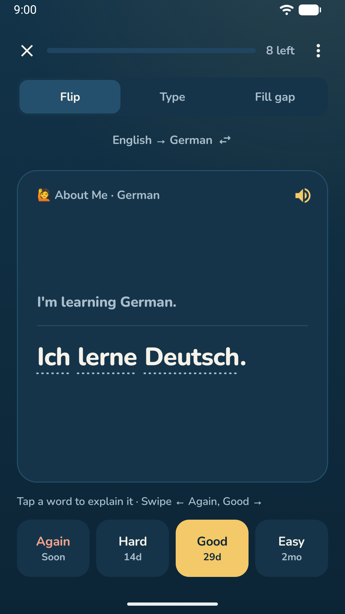
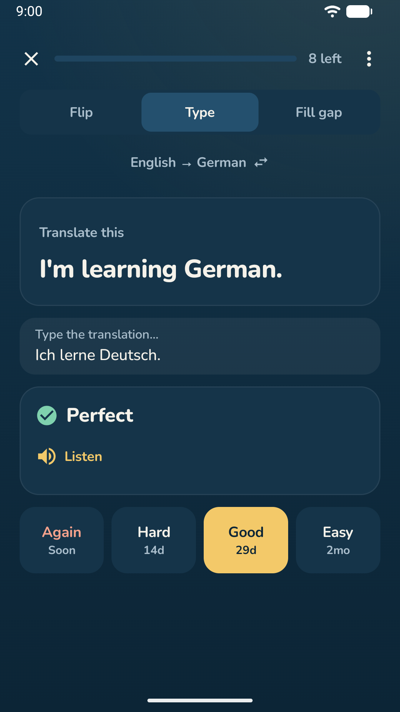
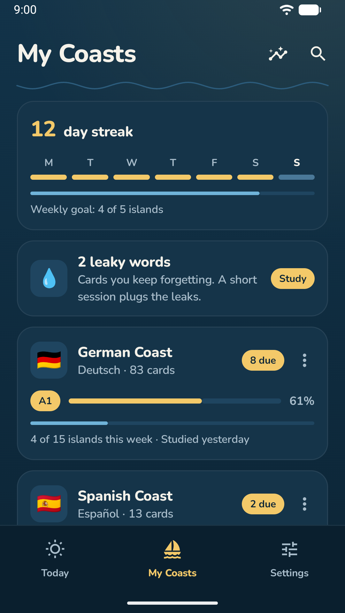
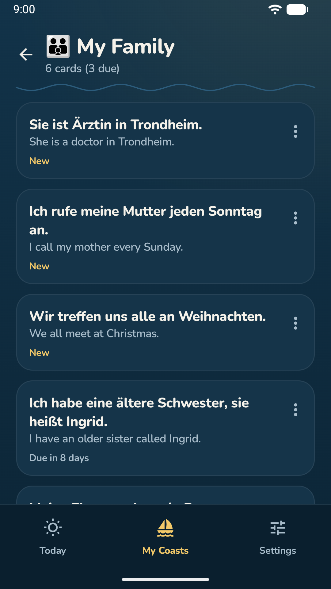
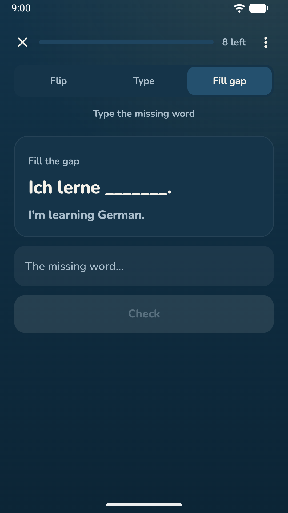
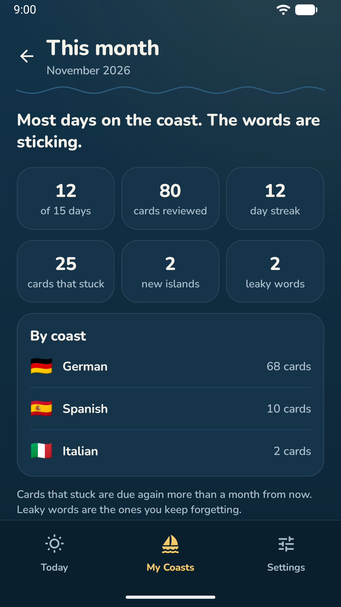
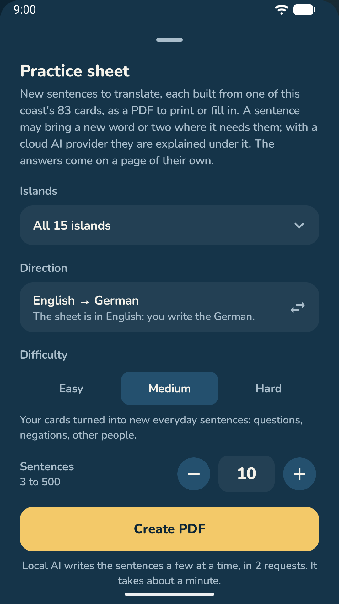
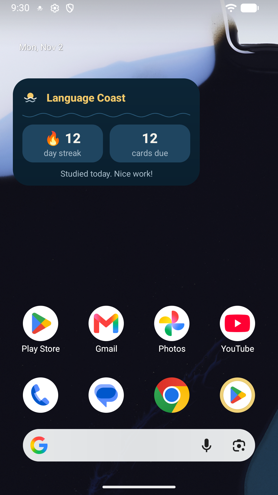
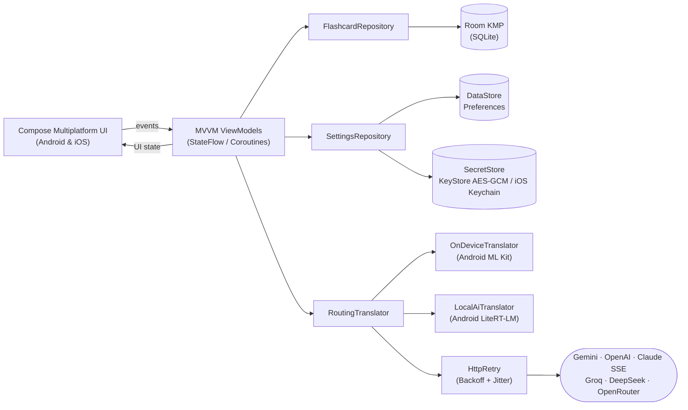

<p align="center">
  
</p>

<h1 align="center">Language Coast</h1>

<p align="center">
  An offline-first spaced-repetition flashcard app for Android and iOS built with Kotlin Multiplatform and Compose Multiplatform, combining an FSRS-5 scheduler with on-device translation (ML Kit / LiteRT-LM) and bring-your-own-key cloud LLMs.
</p>

<p align="center">
  <a href="https://github.com/Andreas-Erick/LanguageCoast/actions/workflows/ci.yml"></a>
  <a href="https://github.com/Andreas-Erick/LanguageCoast/actions/workflows/ios.yml"></a>
  
  <a href="LICENSE"></a>
</p>

---

Language Coast organizes each language you study as a **Coast** (e.g., *German Coast*, *Icelandic Coast*) tailored to a personal goal and regional dialect, with vocabulary grouped into **Language Islands**. Each day presents a finishable session—due reviews scheduled by FSRS-5 followed by a few new sentences—while supporting on-device translation, local LLMs, or your own cloud API key with zero backend server.

## Visual Overview

<p align="center">
  
  
  
  
</p>

<details>
<summary>More screenshots (13 additional views: light theme, fill-gap, alternatives, search, monthly recap, practice sheet, settings, widget &amp; notifications)</summary>

<p align="center">
  
  
  
  
  
  
  
  
  
  
  
  
  
</p>

</details>

---

## Architecture & Design Decisions



- **Shared Multiplatform Core (`shared`):** UI, navigation, ViewModels, Room database, FSRS-5 scheduler, import/export parsers, and Ktor networking live in `commonMain`, with thin `expect`/`actual` platform adapters for SQLite drivers, TTS, hardware-backed secrets, reduced motion, notifications, and Android-only features (ML Kit, LiteRT-LM, PDF worksheets, widgets).
- **Hardware-Backed Secret Isolation & Defense-in-Depth:** Cloud API keys and Hugging Face tokens are stored in [SecretStore](shared/src/commonMain/kotlin/com/andreaserick/languagecoast/data/SecretStore.kt) — encrypted with Android KeyStore AES-256-GCM on Android and stored in iOS Keychain (`kSecAttrAccessibleWhenUnlockedThisDeviceOnly`) on iOS — excluded from cloud/local backups, scrubbed from all diagnostic logs via `redactSecrets()`, and protected by `usesCleartextTraffic="false"`.
- **Deterministic FSRS-5 Engine:** The full [FSRS-5 algorithm](shared/src/commonMain/kotlin/com/andreaserick/languagecoast/data/SpacedRepetition.kt) runs purely in Kotlin with injected `Clock`/`TimeZone` seams, `NaN`/overflow guards, and 250-iteration seeded property-based fuzz tests verifying monotonicity and interval bounds.
- **Resilient Multi-Provider AI Pipeline:** A single `Translator` interface routes between on-device ML Kit, local LiteRT-LM (with hardware RAM/storage/OpenCL profiling, DownloadManager resume tracking, and bounded inference timeouts), and 6 cloud APIs over Ktor with SSE streaming for Claude thinking models and exponential backoff with jitter (`HttpRetry`) for transient HTTP `408`/`429`/`502`/`503`/`504`/`529` failures.
- **Hardened File Parsers:** Streaming Anki `.apkg`/`.colpkg` ingestion (ZIP + zstd + SQLite) enforces exact filename allowlists (Zip Slip protection), entry-count and aggregate byte caps (ZIP bomb protection), real-table verification against crafted SQLite `VIEW`s, and linear-time HTML/cloze parsing (zero ReDoS). Backup JSON decoding checks nesting depth before parsing (`StackOverflowError` prevention), CSV exports neutralize spreadsheet formula injection, and Markdown exports escape raw HTML.

---

## Quickstart

### Prerequisites

- **JDK 21** (or Gradle toolchain auto-provisioning)
- **Android Studio** supporting AGP 9.2+ with Android SDK (API 26+ device or emulator)
- *(Optional, iOS on macOS)* **Xcode** and **[XcodeGen](https://github.com/yonaskolb/XcodeGen)** (`brew install xcodegen`)

### Clone & Build (Android)

```bash
git clone https://github.com/Andreas-Erick/LanguageCoast.git
cd LanguageCoast

# Compile the debug APK
./gradlew assembleDebug
```

Open the project in Android Studio and run the `app` configuration on an Android 8.0+ (API 26) device or emulator. On-device translation works without an API key; cloud providers can be configured inside **Settings > Translation** (keys stay encrypted on-device and are never compiled into the build or stored in `.env`).

For optional local release signing, copy [keystore.properties.example](keystore.properties.example) to `keystore.properties` (git-ignored) and fill in your keystore values.

### Running Tests

```bash
# Run all shared KMP unit, property-fuzz & adversarial security tests + Android ViewModel & chaos tests
./gradlew :shared:testAndroidHostTest :app:testDebugUnitTest

# Run instrumented tests (Room migrations, Anki .apkg/.colpkg reader, PDF worksheets) on a throwaway emulator
./gradlew connectedDebugAndroidTest

# On macOS, run the shared test suite on the iOS Simulator
./gradlew :shared:iosSimulatorArm64Test
```

### Running on iOS (macOS)

```bash
cd iosApp
xcodegen generate
open iosApp.xcodeproj
```

Run on a simulator from Xcode. On iOS, translation uses cloud providers via your own API key (entered in Settings); until a key is set, the card composer defaults to Manual mode. On-device ML Kit, Local AI, file import/export, practice sheet PDFs, OCR photo capture, and the home-screen widget are currently Android-only.

---

## Project Structure

```text
LanguageCoast/
├── shared/src/
│   ├── commonMain/
│   │   ├── kotlin/.../languagecoast/
│   │   │   ├── App.kt                 # Bottom navigation and type-safe NavHost
│   │   │   ├── data/                  # Room DB, repositories, DataStore + SecretStore, FSRS-5,
│   │   │   │                          # HttpRetry, cloud/local translators, Anki/CSV/JSON parsers
│   │   │   ├── di/                    # Koin shared & ViewModel modules
│   │   │   ├── navigation/            # Type-safe Compose navigation routes
│   │   │   ├── notifications/         # Reminder scheduling interface & message selection
│   │   │   └── ui/                    # Feature Screens + ViewModels, shared controls & theme
│   │   └── composeResources/          # Nunito variable font and vector logo mark
│   ├── androidMain/                   # Android KeyStore SecretStore, ML Kit, LiteRT-LM,
│   │                                  # Anki zstd/SQLite reader, PDF printer, TTS, reduced motion
│   ├── iosMain/                       # iOS Keychain SecretStore, BundledSQLite, AVSpeechSynthesizer,
│   │                                  # UNUserNotificationCenter, reduced motion
│   ├── commonTest/                    # FSRS, parser, HttpRetry, property-fuzz & adversarial security tests
│   └── androidHostTest/               # Live localhost SSE streaming tests for Claude
├── app/
│   ├── src/main/                      # Android entry point, WorkManager reminders, AppWidgetProvider
│   ├── src/test/                      # ViewModel unit tests, Koin DI verification, chaos/monkey tests
│   └── src/androidTest/               # Room migration, Anki .apkg fixture & PDF instrumented tests
├── iosApp/                            # SwiftUI host shell, PrivacyInfo.xcprivacy & XcodeGen spec
├── docs/                              # Privacy policy, screenshots, store listing assets & third-party licenses
└── .github/workflows/                 # Android CI (unit + R8 release smoke + emulator tests), iOS CI & releases
```

---

## Tech Stack

| Layer | Technology |
| --- | --- |
| Multiplatform & UI | Kotlin 2.4, Compose Multiplatform 1.12, Material 3, Navigation Compose |
| Architecture & DI | MVVM (`StateFlow` / unidirectional data flow), Koin 4.1 |
| Persistence & Secrets | Room KMP (SQLite), Jetpack DataStore, Android KeyStore (AES-256-GCM) / iOS Keychain |
| Networking & AI | Ktor Client 3.2 (with `HttpRetry` backoff + jitter), LiteRT-LM (local LLMs), Google ML Kit (translate & OCR) |
| Scheduling & Speech | Pure-Kotlin FSRS-5, WorkManager / `UNUserNotificationCenter`, Android TTS / `AVSpeechSynthesizer` |
| Serialization & Compression | `kotlinx.serialization` JSON, `zstd-jni` (Anki `.apkg`/`.colpkg`) |
| Testing & CI | `kotlin.test`, JUnit 4, `kotlinx-coroutines-test`, seeded property fuzzing, ViewModel chaos & adversarial security suites, GitHub Actions |

---

## Feature Highlights

- **Daily Focus Sessions (Today):** Caps daily reviews by pace (*Steady* 3 new/day, *Fast* 10, *Sprint* 20) with automatic welcome-back scaling after 3+ days away, background sentence suggestions tailored to your coast's goal/region, and a 900-sentence starter bank across 37 topics.
- **Flexible Translation & Card Creation:** Switch between On-Device ML Kit (offline), Local AI via LiteRT-LM (offline, auto-categorization, alternatives), Cloud AI (**Gemini**, **OpenAI**, **Claude**, **Groq**, **DeepSeek**, **OpenRouter** with explicit per-provider consent), *I write it* correction mode, Manual mode, and batch capture from pasted text or photos (Android OCR).
- **CEFR Route & Personal Islands:** Track A1–B1 progression per coast, generate custom personal islands from optional *About you* answers, rehearse any island as a spoken talk, drill *Leaky words*, and print AI-generated **Practice Sheet PDFs** (Android) weighted toward slipping FSRS cards.
- **Multi-Mode Study:** Focus-mode **Flip** (swipe or tap), **Type** (accent-aware matching with alternatives), and **Fill gap** modes in both directions, plus offline read-aloud, in-context word explanations with **dict.cc** lookup, *Check translation*, and *Ask about this card* follow-up chat.
- **Portability & Reminders:** Full JSON backup/restore (excluding secrets), Anki `.apkg`/`.colpkg` & CSV/TSV import, Anki/CSV/Markdown export, local WorkManager/`UNUserNotificationCenter` reminders (with Android inline Reveal/Grade notification actions), monthly recaps, and an Android home-screen widget.
- **Supported Languages (30):** 28 dict.cc languages (Albanian, Bosnian, Bulgarian, Croatian, Czech, Danish, Dutch, English, Esperanto, Finnish, French, German, Greek, Hungarian, Icelandic, Italian, Latin, Norwegian, Polish, Portuguese, Romanian, Russian, Serbian, Slovak, Spanish, Swedish, Turkish, Ukrainian) plus Japanese and Korean.

---

## Design & Accessibility

Language Coast uses a custom deep-ocean dark palette and a warm-sand daylight palette (without pure `#FFFFFF` or dead grays), with one sunlit gold accent reserved strictly for primary actions and due indicators:

- **WCAG AA Contrast:** Every text and interactive boundary token meets WCAG AA contrast across every surface in both dark and light themes ([Color.kt](shared/src/commonMain/kotlin/com/andreaserick/languagecoast/ui/theme/Color.kt), [Theme.kt](shared/src/commonMain/kotlin/com/andreaserick/languagecoast/ui/theme/Theme.kt)).
- **Typography & Motion:** Set in the [Nunito](docs/licenses/Nunito-OFL.txt) variable font with tabular numerals (`tnum`) on dynamic counters/timers/progress stats, `>= 48dp` interactive targets, locale-tagged screen-reader spans, and OS reduced-motion support (disabling confetti, 3D card flips, and ambient glides when enabled).

---

## Releases & Privacy

- Signed Android APKs and Play App Bundles are published via [release.yml](.github/workflows/release.yml) on semantic version tags (`vX.Y.Z`), alongside iOS TestFlight uploads via [ios-release.yml](.github/workflows/ios-release.yml).
- See [docs/privacy-policy.md](docs/privacy-policy.md) for data handling details and [docs/store/README.md](docs/store/README.md) for Play Store / App Store declarations.

## License

Copyright © 2026 Andreas Erick. All rights reserved. The source code is public for reference only; see [LICENSE](LICENSE). Third-party components retain their own licenses (see [docs/licenses/THIRD-PARTY.md](docs/licenses/THIRD-PARTY.md)).
