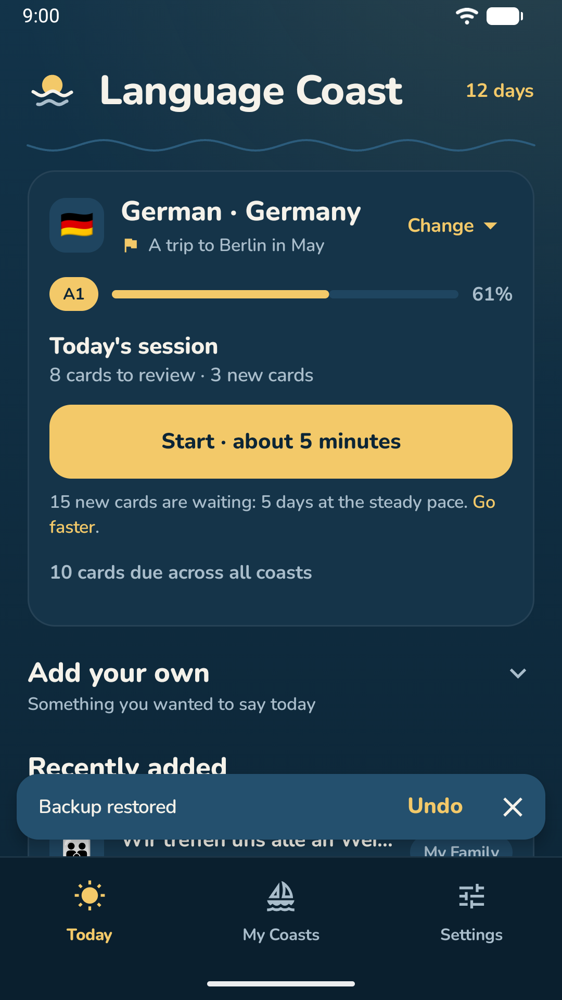
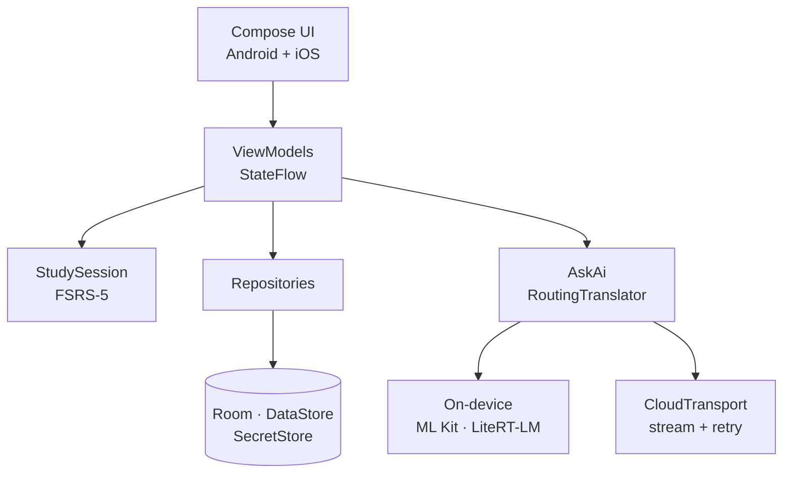
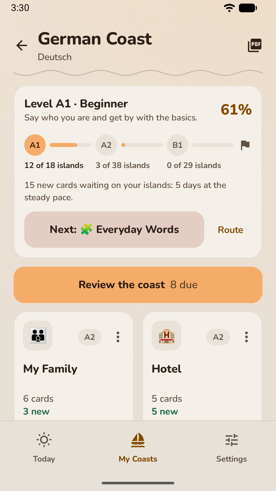
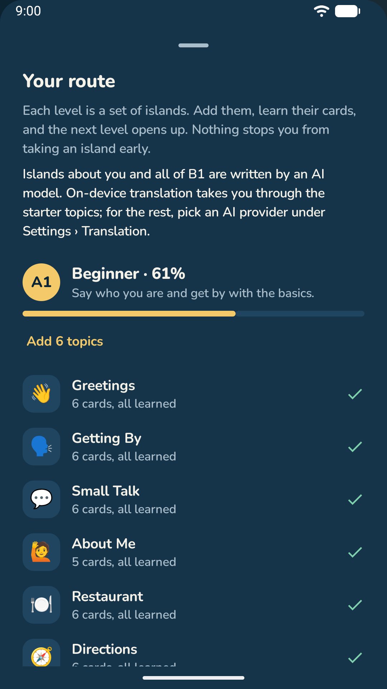
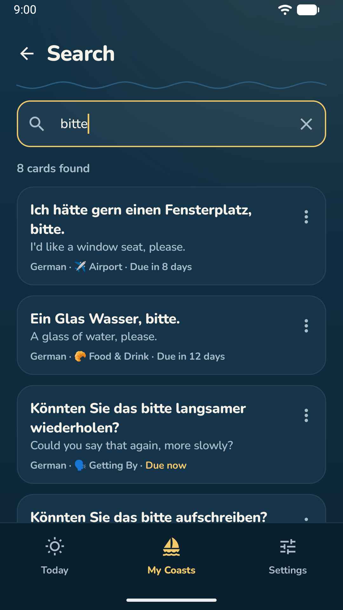
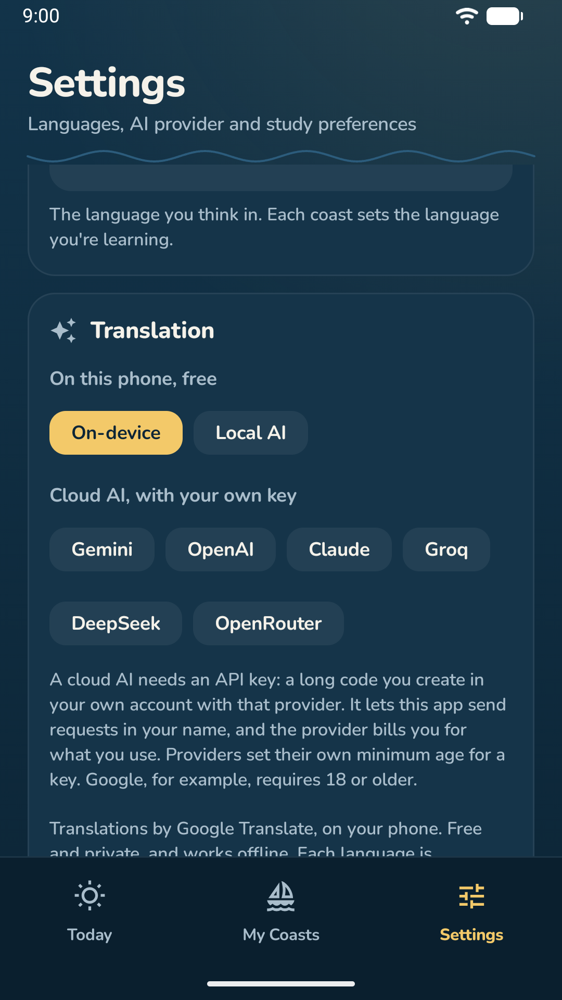
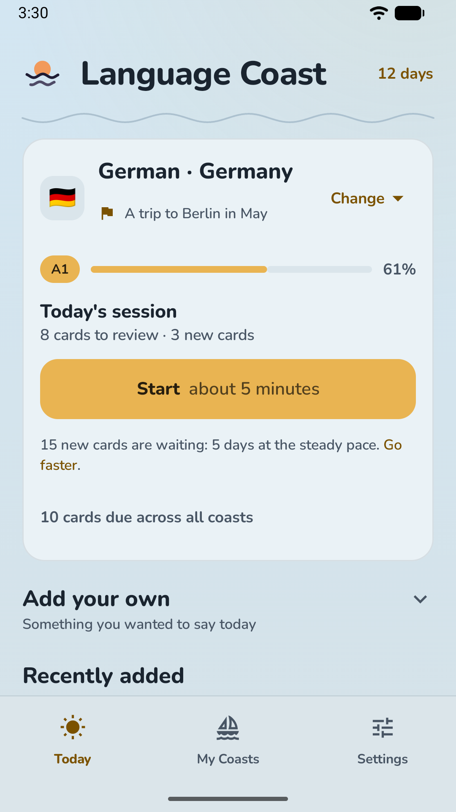
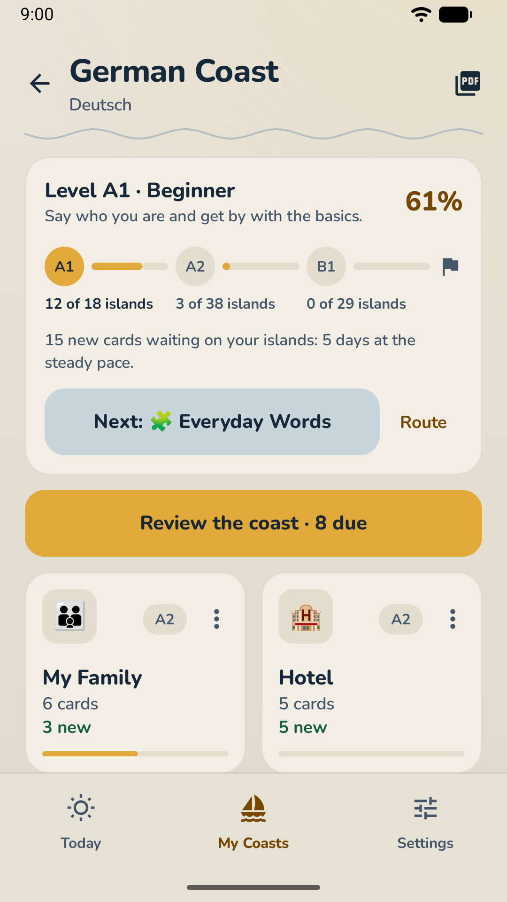
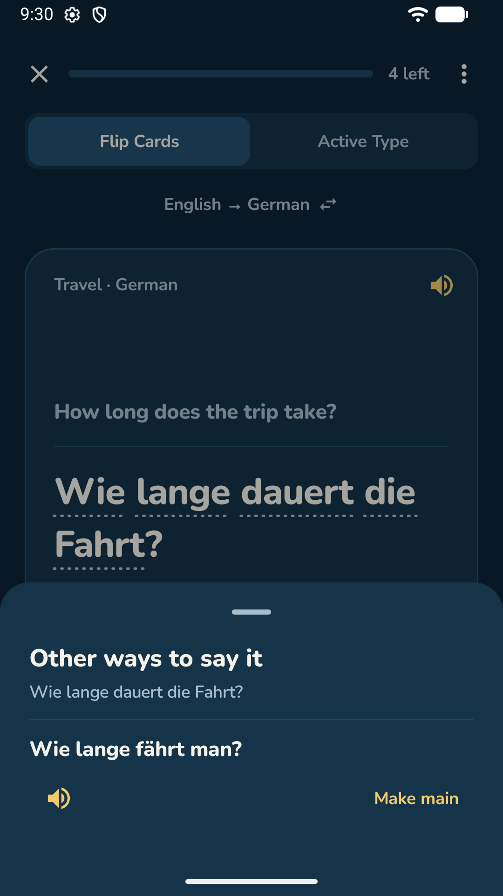
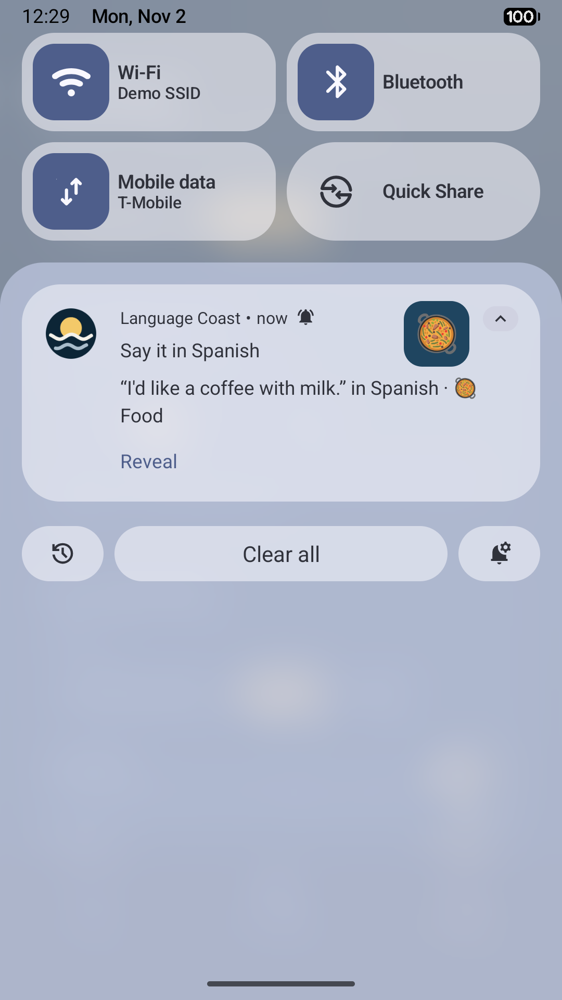

<p align="center">
  
</p>

<h1 align="center">Language Coast</h1>

<p align="center">
  A spaced-repetition app for learning languages from whole
  sentences, on Android and iOS. One Kotlin Multiplatform
  codebase. No account and no backend: AI runs on the phone
  or on your own API key.
</p>

<p align="center">
  <a href="https://github.com/Andreas-Erick/LanguageCoast/actions/workflows/ci.yml"></a>
  <a href="https://github.com/Andreas-Erick/LanguageCoast/actions/workflows/ios.yml"></a>
  <a href="https://github.com/Andreas-Erick/LanguageCoast/releases/latest"></a>
  
  <a href="LICENSE"></a>
</p>

<p align="center">
  
  
</p>

Each language is a **coast**, set up around your goal and
region. Its vocabulary sits on **islands**. Every day you
get a session you can finish: the reviews that are due,
scheduled by FSRS-5, then a few new sentences at the pace
you picked.

## Goals and non-goals

**Goals**

- A daily session you can finish, capped by pace (Steady
  3, Fast 10 or Sprint 20 new sentences a day).
- What matters works offline: scheduling, storage, and
  translation on the phone (Android).
- Your data is yours: on the phone, or in a JSON backup
  you can move.

**Non-goals**

- **No account, sync or server.** Moving to a new phone
  means a backup file.
  ([ADR-0002](docs/adr/0002-on-device-or-own-key-ai-no-backend.md))
- **No bundled API key.** Cloud AI is opt-in for each
  provider, with your own key.
- **No iOS parity for on-device AI.** ML Kit, Local AI,
  practice sheet PDFs, OCR and the widget are Android-only.
  ([ADR-0001](docs/adr/0001-share-ui-with-compose-multiplatform.md))
- **No FSRS fitted to each user** yet: the published
  FSRS-5 defaults.
  ([ADR-0003](docs/adr/0003-fsrs-5-with-default-parameters.md))

## Architecture



Dependencies point one way, down:

- `data/` holds the rules: FSRS-5, study sessions, answer
  checks, parsers and AI routing. It imports nothing from
  Compose or Android.
- User choices go through ViewModels, and no screen
  touches the database.
- Platform code sits behind `expect`/`actual`: secrets,
  the SQLite driver, speech, notifications, file pickers.

```text
shared/src/
  commonMain/   UI, ViewModels, Room, FSRS, AI
  androidMain/  KeyStore, ML Kit, LiteRT-LM,
                Anki reader, PDF, speech
  iosMain/      Keychain, SQLite, speech
  commonTest/   FSRS, parsers, fuzz, security
  androidHostTest/  CloudTransport, local server
shared/schemas/ Room schema of each version
app/            Android entry, widget, reminders
iosApp/         SwiftUI host, XcodeGen spec
```

## Key decisions

| Decision | Choice | Cost |
| --- | --- | --- |
| [UI sharing](docs/adr/0001-share-ui-with-compose-multiplatform.md) | Compose MP | Android-only features |
| [AI and data](docs/adr/0002-on-device-or-own-key-ai-no-backend.md) | Phone or own key | No managed quota |
| [Scheduler](docs/adr/0003-fsrs-5-with-default-parameters.md) | FSRS-5 defaults | No per-user fit |

<details>
<summary><b>How failure is handled</b></summary>

- **Cloud calls** all go through one `CloudTransport`. It
  reads answers as a stream, gives up on a provider that
  goes silent, and retries 408, 429, 502, 503, 504 and 529
  with backoff and jitter, honouring `Retry-After`. Users
  get plain messages: bad key, out of credit, too much at
  once, no connection.
- **API keys** live in the Android KeyStore (AES-256-GCM)
  or the iOS Keychain. They are left out of backups and
  scrubbed from logs.
- **Imported files are untrusted.** The Anki `.apkg`
  reader caps entries and bytes, allows only known file
  names and rejects crafted SQLite views. A backup is
  depth-checked before it is parsed, validated before
  anything is restored, and restored in one transaction.
- **Migrations** are checked against the Room schema kept
  in `shared/schemas/`, starting from v2 and from v9.
- **The release build** is minified by R8. CI starts it
  on an emulator and fails if it crashes.

</details>

## Quickstart

You need JDK 21 and the Android SDK, and a device or
emulator on Android 8.0 (API 26) or later. For iOS you also
need macOS, Xcode and XcodeGen; the app runs on iOS 16+.

```bash
git clone \
  https://github.com/Andreas-Erick/LanguageCoast.git
cd LanguageCoast
./gradlew assembleDebug
```

Translation on the phone works without a key. To use cloud
AI, add a key under **Settings › Translation**. It is
stored encrypted on the device.

### Tests

```bash
# Unit, property-fuzz and adversarial tests
./gradlew :shared:testAndroidHostTest \
  :app:testDebugUnitTest

# Migrations, Anki reader, PDFs (emulator)
./gradlew connectedDebugAndroidTest

# Shared tests on the iOS simulator (macOS)
./gradlew :shared:iosSimulatorArm64Test
```

### Run what CI runs

```bash
# Lint, unit tests and the debug APK
./gradlew verify

# The minified release build CI starts
./gradlew assembleRelease \
  -PallAbis=true -PidSuffix=.r8
```

### iOS

```bash
cd iosApp
xcodegen generate
open iosApp.xcodeproj
```

## Features

- **Today:** due reviews, then new sentences from a
  900-sentence starter bank across 37 topics, or ones
  written by AI for your goal. A gentle restart after 3 or
  more days away.
- **Study:** Flip, Type (accent-aware) and Fill gap, in
  both directions, with read-aloud, word explanations and
  dict.cc lookups, *Check translation* and *Ask about this
  card*.
- **Route:** A1 to B1 on each coast, personal islands
  from *About you*, spoken talks, and practice sheet PDFs
  weighted toward cards you keep forgetting (Android).
- **Your data:** JSON backup and restore (keys left out),
  Anki `.apkg`/`.colpkg` and CSV import, and Anki, CSV and
  Markdown export.
- **30 languages:** the 28 on dict.cc, plus Japanese and
  Korean.

<details>
<summary><b>More screenshots</b></summary>

<p align="center">
  
  
  
  
  
  
  
  
  
  
  
  
  
  
  
</p>

</details>

## Look and accessibility

- **Follow the sun** is the default look: five
  time-of-day palettes, from sunrise to night, blended at
  your local sun times. Classic, Dark, Light and Like the
  phone are there too.
- Text contrast in every palette is checked by a test
  (`SkyClockTest`), not by eye.
- Nunito with tabular numbers, touch targets of 48 dp or
  more, screen-reader text tagged with its language, and
  the phone's reduced-motion setting honoured.

## Releases

Pushing a tag `vMAJOR.MINOR.PATCH` (minor and patch 0–99,
no suffix) builds a signed APK and app bundle and publishes
a GitHub Release. Tag a commit whose CI run passed.

Android needs these repository secrets:
`KEYSTORE_BASE64`, `KEYSTORE_PASSWORD`, `KEY_ALIAS` and
`KEY_PASSWORD`.

The same tag uploads the iOS app to TestFlight when these
are set (it is skipped without them):
`APP_STORE_CONNECT_KEY_BASE64`,
`APP_STORE_CONNECT_KEY_ID`,
`APP_STORE_CONNECT_ISSUER_ID` and `APPLE_TEAM_ID`.

Each release attaches
`LanguageCoast-vX.Y.Z-mapping.txt.gz`. To read a crash from
that APK, unzip it and pass it with the stack trace to R8's
`retrace`.

For signing on your own machine, copy
[keystore.properties.example](keystore.properties.example)
to `keystore.properties`, which git ignores.

## Privacy and license

See the [privacy policy](docs/privacy-policy.md) and the
[store declarations](docs/store/README.md). Security
reports: [SECURITY.md](SECURITY.md).

Copyright © 2026 Andreas Erick. All rights reserved. The
code is public for reference only; see [LICENSE](LICENSE).
Third-party parts keep their own licenses
([THIRD-PARTY.md](docs/licenses/THIRD-PARTY.md)).
